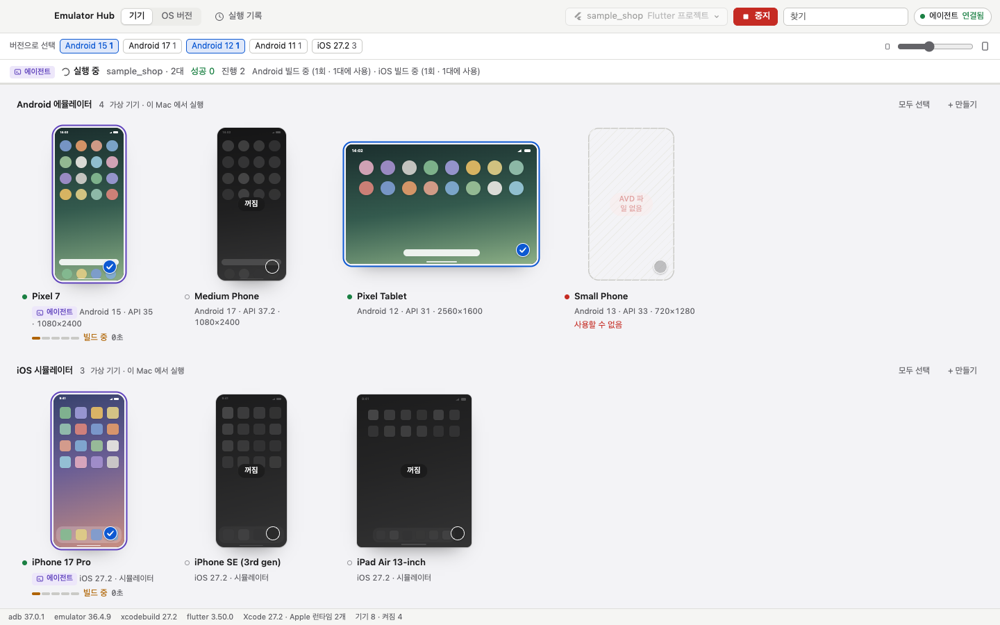
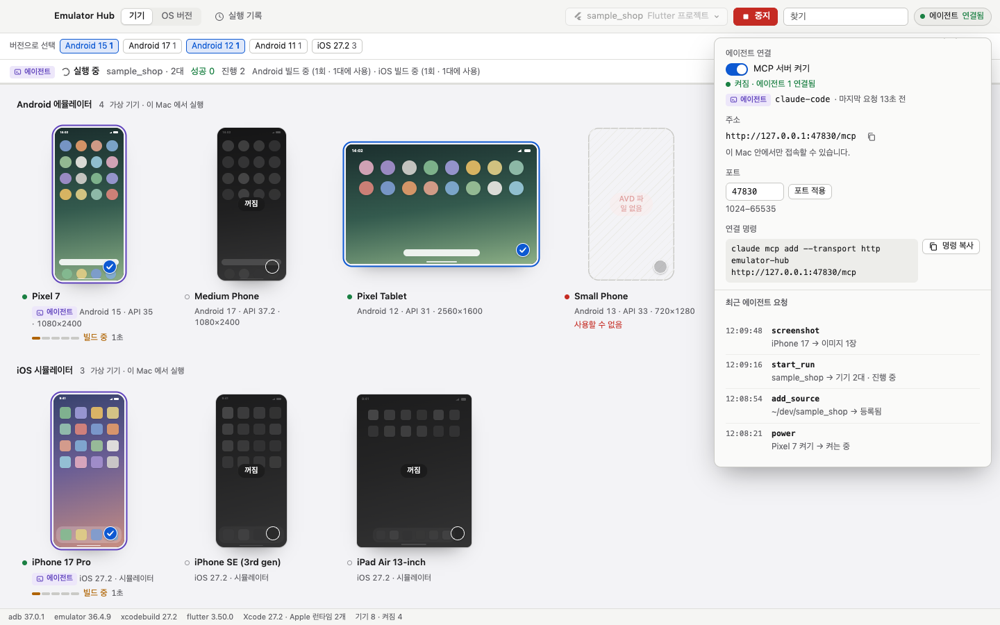

<div align="center">

# Emulator Hub

**Mac 의 모든 Android 에뮬레이터와 iOS 시뮬레이터를 한 갤러리에서.**<br>
기기를 고르면 앱을 한 번에 빌드 · 설치 · 실행하고 화면까지 찍습니다.

[](https://github.com/soimadeone/emulator-hub/releases/latest)

   

[English](README.md) · 한국어

<picture>
  <source media="(prefers-color-scheme: dark)" srcset="docs/images/gallery-dark.png">
  
</picture>

</div>

> [!NOTE]
> 지금 앱 화면은 **한국어만** 지원합니다. 영어 화면은 준비 중입니다. 스크린샷은 예시 데이터입니다.

## 왜 만들었나

빌드 하나를 여러 기기에서 확인하려면 터미널을 오가야 합니다. 에뮬레이터를 하나씩 켜고, 부팅을 기다리고, `flutter build`, `adb install`, `xcrun simctl install`, 실행, 스크린샷을 기기 수만큼 반복합니다. Emulator Hub 는 이 일을 한 화면, 버튼 하나로 줄입니다.

## 기능

| 기능 | 설명 |
|---|---|
| **한 갤러리** | Android AVD, iOS 시뮬레이터, USB 로 연결한 Android 폰을 나란히, 실시간 화면 그림과 함께 봅니다. 망가진 AVD 는 숨기지 않고 표시합니다. |
| **일괄 실행** | Flutter 프로젝트, `.apk`, 시뮬레이터용 `.app` 중 하나를 고르고 기기를 골라 실행합니다. 플랫폼마다 한 번만 빌드하고, 고른 기기 모두에 동시에 설치 · 실행 · 스크린샷합니다. |
| **분명한 결과** | 기기별 상태, 실패한 단계와 오류, 스크린샷, 앱 로그를 보여 줍니다. 서명 충돌은 버튼 하나로 지우고 다시 설치합니다. |
| **실행 기록** | 최근 실행을 스크린샷과 함께 남겨 빌드끼리 비교할 수 있습니다. |
| **기본은 창 없이** | 에뮬레이터를 창 없이 켜도 화면 그림은 계속 보입니다. 실제 창이 필요하면 기기 메뉴에서 엽니다. |
| **OS 버전** | Android 시스템 이미지와 iOS 런타임을 받고 지우고, 그 버전으로 기기를 만듭니다. 갤러리를 OS 버전으로 골라 볼 수 있습니다. |
| **화면 크기** | Android 에뮬레이터를 만들 때 해상도를 정하거나, 켜진 기기에서 바로 바꿉니다 (Android 전용). |
| **환경 점검** | 없는 SDK · 도구 · 런타임을 찾아 고칠 명령을 그대로 알려 줍니다. |
| **AI 에이전트 (MCP)** | 내장 MCP 서버로 Claude Code 같은 에이전트가 같은 기기를 다룹니다. 아래를 보세요. |

## AI 에이전트 (MCP)

앱이 켜져 있으면 `http://127.0.0.1:47830/mcp` 에서 [MCP](https://modelcontextprotocol.io) 서버(Streamable HTTP)가 열립니다. Claude Code 는 이렇게 연결합니다.

```sh
claude mcp add --transport http emulator-hub http://127.0.0.1:47830/mcp
```

그다음 *"이 APK 를 Android 에뮬레이터 전부에 깔고 실행해서 화면 보여 줘"* 처럼 부탁하면 됩니다.

<picture>
  <source media="(prefers-color-scheme: dark)" srcset="docs/images/agent-dark.png">
  
</picture>

툴바에서 에이전트 연결 여부와 최근 요청을 봅니다. 에이전트가 켠 기기와 시작한 실행에는 보라색 **에이전트** 표시가 붙어 누가 무엇을 하는지 바로 보입니다. 앱과 에이전트는 실행 하나를 함께 씁니다. 한쪽이 실행 중이면 다른 쪽은 실행 id 와 함께 "실행 중" 답을 받습니다.

| 도구 | 하는 일 |
|---|---|
| `list_devices` | 기기 목록 (상태, OS, 화면, 마지막 앱. 플랫폼 · 상태로 거르기) |
| `power` | 기기 켜기 · 끄기, 부팅 끝까지 기다리기 |
| `list_sources` · `add_source` | Flutter 프로젝트, `.apk`, `.app` 목록 보기 · 등록 |
| `start_run` | 소스 하나를 여러 기기에 한 번에 빌드 · 설치 · 실행 |
| `get_run` · `stop_run` | 실행 따라가기 · 멈추기. 끝난 기기 스크린샷은 이미지로 |
| `reinstall` | 실패한 Android 기기 한 대만 지우고 다시 설치 |
| `screenshot` | 켜진 기기의 지금 화면을 이미지로 |
| `read_logs` | 앱 로그 최근 줄, 수준으로 거르기 |
| `list_runs` | 최근 실행 기록 |

> [!TIP]
> Claude Code 는 MCP 호출을 기본 약 60초에 끊습니다. 그래서 오래 걸리는 일은 50초에 `done: false` 로 돌아오고, 에이전트가 `get_run` 으로 이어 받습니다. 한 번에 더 기다리려면 서버 설정의 `timeout` 이나 `MCP_TOOL_TIMEOUT` 을 늘리세요.

**보안.** 서버는 `127.0.0.1` 에서만 열리고, `Origin` 이나 `Host` 가 localhost 가 아닌 요청은 거절해서 웹 페이지가 부를 수 없습니다. 인증은 없어서 이 Mac 의 어떤 프로그램이든 쓸 수 있습니다. 툴바의 **에이전트** 버튼에서 끄거나 포트를 바꿀 수 있습니다.

## 설치

1. [Releases](https://github.com/soimadeone/emulator-hub/releases) 에서 `.dmg` 를 받아 **Emulator Hub** 를 응용 프로그램 폴더로 끌어 넣습니다.
2. 아직 서명하지 않은 빌드라 처음 열 때 macOS 가 막습니다. **시스템 설정 › 개인정보 보호 및 보안** 에서 **그래도 열기** 를 누르세요.

### 요구 사항

- Apple Silicon **macOS**
- **Android**: `emulator` 와 `platform-tools` 가 있는 Android SDK. 기기 만들기와 시스템 이미지 받기에는 `cmdline-tools` 가 필요합니다. SDK 는 앱 설정, `ANDROID_HOME`, `ANDROID_SDK_ROOT`, `~/Library/Android/sdk` 순서로 찾습니다.
- **iOS**: 시뮬레이터 런타임이 하나 이상 있는 Xcode
- **Flutter** (선택): Flutter 프로젝트를 빌드할 때만. 이미 빌드된 `.apk` · `.app` 은 없어도 됩니다.

쓰는 플랫폼만 있으면 됩니다. 없는 도구는 앱이 고칠 방법과 함께 알려 줍니다.

## 개인정보

- **사용 정보를 보내지 않습니다.** 텔레메트리 · 분석 · 오류 보고가 없고, 자동 업데이트도 없습니다.
- **네트워크.** 앱이 직접 받는 것은 하나입니다: 받을 수 있는 버전 목록을 열 때 Apple 의 공개 시뮬레이터 런타임 목록을 하루 한 번까지. 시스템 이미지 목록 보기 · 받기에 쓰는 Android `sdkmanager` 는 Android Studio 에서와 같이 Google 의 SDK 저장소에 연결합니다.
- 설정 · 실행 기록 · 스크린샷은 이 Mac 의 `~/Library/Application Support/Emulator Hub` 에만 있습니다.

## 아직 지원하지 않는 것

- 앱 안 실시간 화면 미러링 · 원격 조작 (화면 그림만)
- iOS 실기기, Windows · Linux
- Android Studio · Xcode 네이티브 프로젝트 빌드 (빌드된 파일로 설치하세요)
- iOS 화면 크기 바꾸기 (기기 종류에 고정)

## 의견

버그나 아이디어가 있으면 [이슈](https://github.com/soimadeone/emulator-hub/issues) 를 남겨 주세요.

## 라이선스

Copyright (c) 2026 So I Made One. All rights reserved. 공식 빌드는 [LICENSE](LICENSE) 의 조건으로 무료로 쓸 수 있습니다. 소스 코드는 공개하지 않으며, 이 저장소에는 설치 파일 · 릴리스 노트 · 이슈만 둡니다.
