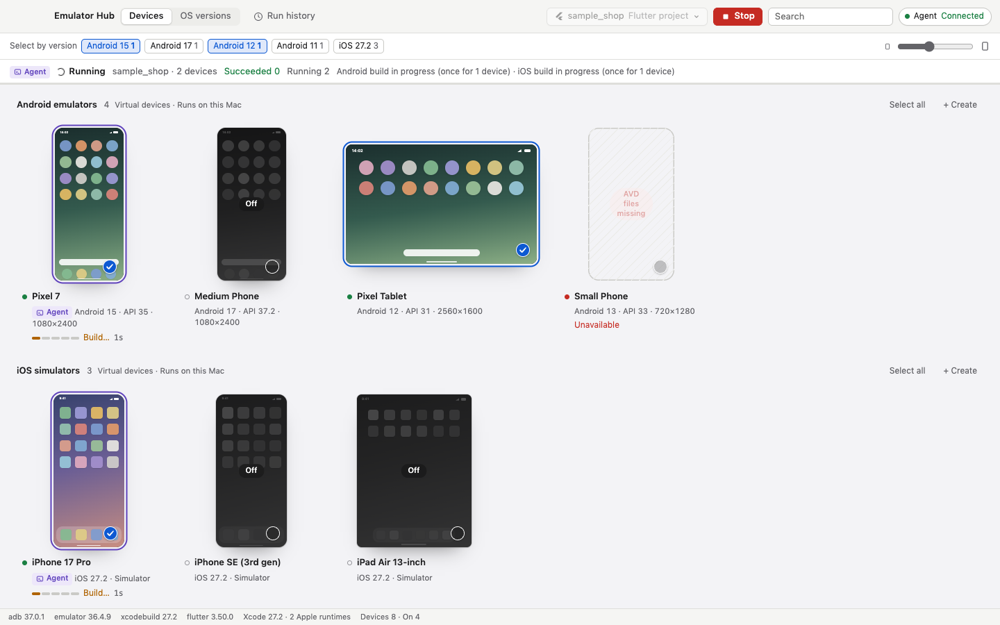
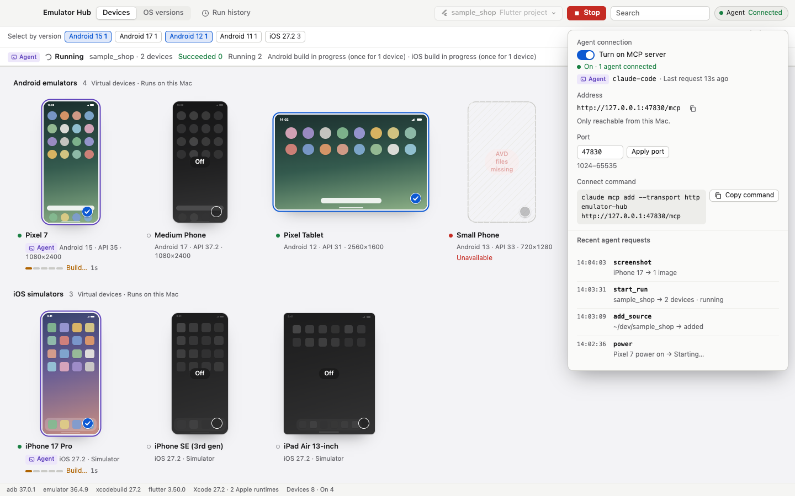

<div align="center">

# Emulator Hub

**Every Android emulator and iOS simulator on your Mac, in one gallery.**<br>
Pick devices, then build, install, run and screenshot your app on all of them at once.

[](https://github.com/soimadeone/emulator-hub/releases/latest)

   

English · [한국어](README.ko.md)

<picture>
  <source media="(prefers-color-scheme: dark)" srcset="docs/images/gallery-dark.png">
  
</picture>

</div>

> [!NOTE]
> The app is available in **English and Korean**. It follows your macOS language; change it in **View › Language**. Screenshots use sample data.

## Why

Testing one build on several devices usually means juggling terminals: start each emulator, wait for boot, `flutter build`, `adb install`, `xcrun simctl install`, launch, screenshot, repeat. Emulator Hub turns that into one screen and one button.

## Features

| Feature | Details |
|---|---|
| **One gallery** | Android AVDs, iOS simulators and USB-connected Android phones side by side, with live screen thumbnails. Broken AVDs are flagged instead of hidden. |
| **Batch run** | Choose a Flutter project, `.apk` or simulator `.app`, select devices, press run. Each platform is built once, then installed, launched and screenshotted on every selected device in parallel. |
| **Clear results** | Per-device status, the step that failed and its error, screenshots and app logs. One-click recovery for signature conflicts (uninstall and reinstall). |
| **Run history** | Recent runs are kept with screenshots, so you can compare builds later. |
| **Headless by default** | Emulators boot without a window and still render thumbnails. Open a real window from the device menu when you need it. |
| **OS versions** | Download and remove Android system images and iOS runtimes, then create devices from them. Filter the gallery by OS version. |
| **Screen sizes** | Set the resolution when creating an Android emulator, or change it on a running one (Android only). |
| **Environment check** | Detects missing SDKs, tools and runtimes, and tells you the exact command to fix it. |
| **AI agents (MCP)** | A built-in MCP server lets Claude Code and other agents drive the same devices. See below. |

## AI agents (MCP)

While the app is running it serves an [MCP](https://modelcontextprotocol.io) server at `http://127.0.0.1:47830/mcp` (Streamable HTTP). Connect Claude Code with:

```sh
claude mcp add --transport http emulator-hub http://127.0.0.1:47830/mcp
```

Then ask things like *"Install this APK on every Android emulator, run it and show me the screens."*

<picture>
  <source media="(prefers-color-scheme: dark)" srcset="docs/images/agent-dark.png">
  
</picture>

The toolbar shows whether an agent is connected and lists its recent requests. Devices and runs started by an agent get a purple **agent** tag, so you always know who is doing what. The app and agents share one run queue: if one side is running, the other gets a clear "busy" answer with the run id.

| Tool | What it does |
|---|---|
| `list_devices` | Devices with state, OS, screen and last app (filter by platform or state) |
| `power` | Turn devices on or off, optionally waiting until booted |
| `list_sources` · `add_source` | List or register a Flutter project, `.apk` or `.app` |
| `start_run` | Build, install and run a source on many devices at once |
| `get_run` · `stop_run` | Follow or stop a run; finished screenshots come back as images |
| `reinstall` | Uninstall and reinstall on one failed Android device |
| `screenshot` | Current screen of a running device, as an image |
| `read_logs` | Recent app log lines, filtered by level |
| `list_runs` | Recent run history |

> [!TIP]
> Claude Code cuts MCP calls off after about 60 seconds by default, so long waits return after 50 seconds with `done: false` and the agent continues with `get_run`. To wait longer in one call, raise `timeout` in the server config or set `MCP_TOOL_TIMEOUT`.

**Security.** The server listens on `127.0.0.1` only and rejects requests whose `Origin` or `Host` is not localhost, so web pages cannot call it. There is no authentication: any program on your Mac can use it. You can turn it off or change the port from the **agent** button in the toolbar.

## Install

1. Download the `.dmg` from [Releases](https://github.com/soimadeone/emulator-hub/releases) and drag **Emulator Hub** to Applications.
2. The build is not signed yet, so macOS blocks the first launch. Open **System Settings › Privacy & Security** and choose **Open Anyway**.

### Requirements

- **macOS** on Apple Silicon
- **Android**: Android SDK with `emulator` and `platform-tools`. `cmdline-tools` is needed to create devices and download system images. The SDK is found via the app setting, `ANDROID_HOME`, `ANDROID_SDK_ROOT`, then `~/Library/Android/sdk`.
- **iOS**: Xcode with at least one simulator runtime
- **Flutter** (optional): only for building Flutter projects. Prebuilt `.apk` / `.app` files work without it.

You only need the platforms you use. Missing tools show up in the app with a fix.

## Privacy

- **No usage data.** No telemetry, analytics or crash reports, and no automatic updates.
- **Network.** The app itself fetches one thing: Apple's public simulator runtime list, when you open the download list, at most once a day. The Android `sdkmanager` it runs to list and download system images talks to Google's SDK repository, as it does in Android Studio.
- Settings, run history and screenshots stay on your Mac in `~/Library/Application Support/Emulator Hub`.

## Not supported (yet)

- Live screen mirroring or remote control inside the app (thumbnails only)
- iOS physical devices, Windows and Linux
- Building native Android Studio / Xcode projects (install their built files instead)
- Changing iOS screen size (fixed by device type)

## Feedback

Found a bug or have an idea? [Open an issue](https://github.com/soimadeone/emulator-hub/issues).

## License

Copyright (c) 2026 So I Made One. All rights reserved. The official builds are free to use under the terms in [LICENSE](LICENSE). The source code is not public; this repository holds the installers, release notes and the issue tracker.
